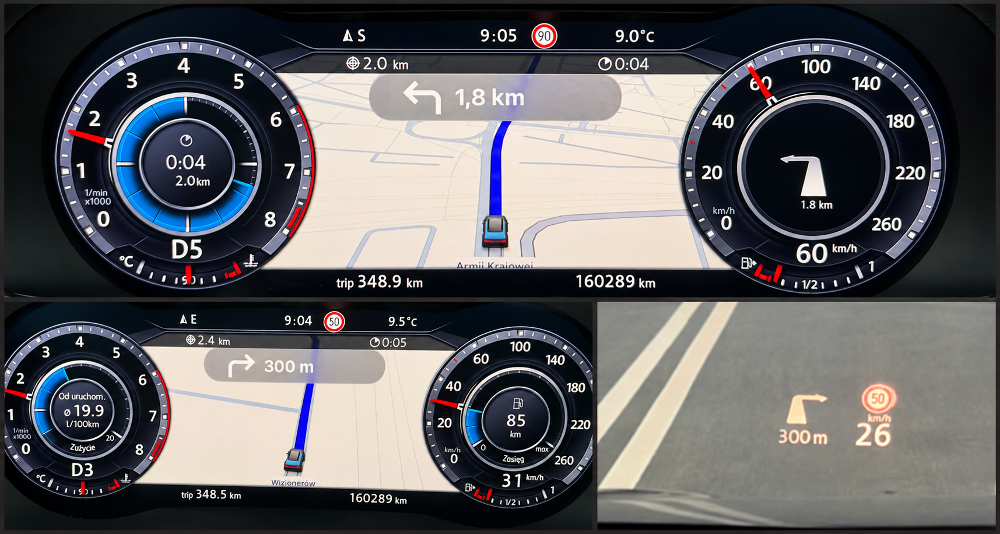

# CarPlay Maps VC for MHI2: MU1367 / MU1427 / AID 791

**CarPlay maps and native navigation guidance on the Volkswagen Active Info Display, with firmware-matched adapters for MHI2 MU1367 and MU1427.**

[Download](#download) · [Install](#installation) · [Display options](#display-options) · [Changelog](#changelog) · [Support](#support-this-project) · [Origin](#origin-and-upstream-project)

**MU1367 / MU1427 development: [tomasz-twardzicki](https://github.com/tomasz-twardzicki)** · Based on [CarPlay Maps VC](https://github.com/omonob/MHI2-Carplay-Maps) by **[omonob (汽车大玩家)](https://github.com/omonob)**

---

> [!WARNING]
> **Use entirely at your own risk.** This project modifies files on your car's infotainment unit. A failed or interrupted install can leave the unit unable to boot. All code, scripts and packages are provided as-is, without warranty of any kind. Neither the original author nor the contributors of this fork are responsible for any damage, malfunction, data loss, warranty or legal consequences, or anything else that results from using them. See [Disclaimer](#disclaimer).

## Overview

This fork extends CarPlay Maps VC on **MU1367** and ports it to **MU1427**, with the **791 AID 12.3** virtual cockpit. Each firmware has its own package and matched HMI adapters; use the installation guide for your exact version.

It combines the phone-rendered CarPlay map and optional turn card with the cockpit's own navigation graphics: native maneuver arrows, distance to the next turn, remaining route distance and travel time. MU1367 also includes native MU settings, road names, arrow progress, lane recommendations and music metadata/artwork; the user reports successful vehicle operation.

The baseline project is by **omonob (QCDWJ)**. **tomasz-twardzicki** developed the firmware adaptations and native guidance additions.

*AID and HUD navigation — edited photo collage.*

## Latest MU1367 / 791 changes

**[MU1367 v1.4.3](https://github.com/tomasz-twardzicki/MHI2-Carplay-Maps/releases/tag/MU1367-v1.4.3)**
adds **experimental P4521 installation** with all current features, retaining the
v1.4.2 U-turn lane fix using the factory VW left/right direction bytes
(114/146), incorporating [PR #8](https://github.com/tomasz-twardzicki/MHI2-Carplay-Maps/pull/8).
It includes maps, native arrows with distance progress, current road in the ETA
bar, native lane recommendations, audio metadata/artwork and reconnect recovery.
Fresh MU settings default to **30 fps / IDR5**. The base disables turn cards and
removes their MU controls; the **Tuning** submenu adds/removes both together.

The earlier P4521 experimental build has been confirmed working in a vehicle.
Separate P4521 experimental installations use the documented OEM reset + reboot
before installing the combined package; snapshots and settings are retained.

One install/update action supports stock, v1.4.0, v1.4.1/v1.4.2 and known test states.
An active integrated v1.4.1/v1.4.2 installation and the v3 test revisions use a checked, snapshot-preserving removal/reboot stage
before release installation. Settings reset archives old choices; Diagnostics
and Recovery have dedicated submenus, including independent matched OEM reset.
Normal map alignment is restored after the unsuccessful right-edge experiment.

**Known limits:** Mini Pico can still show its turn card. Supplied Mini firmware
contains fixed-URL scene handling; the precise Pico implementation remains
unverified and no adapter firmware patch is included. Blank unused-lane slots
match OEM behavior. Refined symbols, OEM recalculation messages, names above the
arrow, and Apple Maps/Waze support remain planned. See [known issues and TODOs](./MU1367/integration/KNOWN-ISSUES.md).

An **[experimental v1.4.3-e reader fix](./releases/MU1367/v1.4.3-e/README.md)** is
published for K4525/P4521 vehicle testing; it retains the v1.4.3 baseline.

Use the [stable v1.4.3 installation and recovery guide](./releases/MU1367/v1.4.3/START_HERE.md)
and [maintained source/build guide](./MU1367/integration/DEVELOPMENT.md).
Earlier packages and tags remain unchanged. These changes apply to exact
**K4525 or P4521 MU1367 + AID 791 (P4521 experimental)**, separately from the MU1427 release below.

## Features (MU1427 / 791)

- **CarPlay map on the virtual cockpit.** MU1427's older AirPlay stack (210.81) keeps the cluster stream's AES key at a different offset. `core.so` is patched to match; without that, every frame decrypts to garbage.
- **Native arrows and maneuver distance on AID and HUD.** The add-on receives the phone's iAP2 guidance and supplies the factory navigation display. Distance uses the OEM formatter, rounding and unit switching; the earlier factor-of-ten error is fixed.
- **Remaining route distance and travel time on AID.** The time is a remaining duration, such as 12 minutes. Clock-time arrival ETA is outside this version.
- **Automatic guidance after boot.** Once installed, the add-on starts with the unit. No manual recorder, shadow check or five-minute test is needed. Guidance clears on route stop, disconnect or stale data; fresh updates restore it, and OEM navigation retains priority.
- **Turn-by-turn card.** The iPhone draws the next-maneuver card on the cockpit map. The default narrow and optional wide cards move **16 pixels lower** to leave room for the native distance/time bar. Map-only positioning is unchanged.
- **Smooth stream.** The cockpit stream requests 30 fps instead of 40, which removed the stutter and lag seen in the car.
- **Display options in the toolbox menu:** the default narrow turn card, a wide turn card, or map only.
- **Steering-wheel control:** short press to zoom the map, long press to switch map views (from the original project).
- **"Ignore navigation-active" for MU1427:** keeps the factory navigation map running in the cockpit while CarPlay navigates. The toolbox's generic patch stops CarPlay from starting on MU1427, so this package includes a build made from MU1427's own HMI classes. The install script picks it automatically.
- **Clean toolbox menu.** The original AUTO MU installers remain available, alongside separate MU1427 native guidance install, status, disable and removal options. A–D research/test entries are removed, and the menu credits both authors.
- **Bounded RAM operation.** Guidance uses a supervised reader and a fixed-size latest-state feed, without recording a route archive or writing navigation captures to SD automatically.
- **Status, diagnostics and restore** entries, including removal of native guidance while keeping the base map-video patch.

Music metadata, cover art, native street/lane graphics and clock-time arrival
ETA are outside this version. The phone-rendered turn card remains available.

**Validation:** D3 unit testing confirmed native AID/HUD arrows, corrected maneuver distance, route distance and travel duration. Reconnection, disconnect clearing and OEM navigation worked in the reported tests. The final package passes host and factory QNX/J9 checks, including installation and rollback. **Automatic startup, operation beyond five minutes and the lowered card position still need their first check on the unit.** See [D3 results](./MU1427/route-guidance/D3-RESULTS.md) and [release verification](./MU1427/route-guidance/RELEASE-VERIFICATION.json).

## Compatibility (MU1427)

| | Supported |
| --- | --- |
| Firmware | **MU1427** (`MHI2_ER_VWG11_K3342_MU1427`), identified by `/ifs/lsd.jxe` = **52,751,492 bytes** |
| Cluster | **791 AID 12.3** |
| Phone | iPhone over USB. Tested with iPhone19,2 on iOS build 24A437; the turn card needs a recent iOS. |

The native guidance installer requires the **MU1427/791 base profile** and checks the firmware and known driver/config sizes before installation. It accepts the factory pair or the tested B4 pair and retains the OEM backups. The 790 installer refuses MU1427; native guidance is not offered for other profiles.

MU1367 uses its separate [compatibility and installation guide](./MU1367/integration/INSTALL.md).
The original standalone profiles remain available ([see below](#origin-and-upstream-project)).

## Download

**MU1367 / AID 791 — v1.4.3 complete integration:**
[Release](https://github.com/tomasz-twardzicki/MHI2-Carplay-Maps/releases/tag/MU1367-v1.4.3) ·
[Full Toolbox ZIP](https://github.com/tomasz-twardzicki/MHI2-Carplay-Maps/releases/download/MU1367-v1.4.3/CarPlay_Maps_VC_MU1367_791_v1.4.3.zip) ·
[SHA-256](https://github.com/tomasz-twardzicki/MHI2-Carplay-Maps/releases/download/MU1367-v1.4.3/SHA256SUMS.txt).
Read [installation, migration and recovery](./MU1367/integration/INSTALL.md).
Supports K4525 and **P4521 (experimental installation)**; the earlier P4521
experimental build has been confirmed working in a vehicle.
The same SD includes the complete fresh-install path and independent OEM reset.

Previous [v1.4.2](https://github.com/tomasz-twardzicki/MHI2-Carplay-Maps/releases/tag/MU1367-v1.4.2),
[v1.4.1](https://github.com/tomasz-twardzicki/MHI2-Carplay-Maps/releases/tag/MU1367-v1.4.1),
[v1.4.0](https://github.com/tomasz-twardzicki/MHI2-Carplay-Maps/releases/tag/MU1367-v1.4.0)
and [v1.3.0](https://github.com/tomasz-twardzicki/MHI2-Carplay-Maps/releases/tag/MU1367-v1.3.0)
assets are preserved unchanged for historical installations.

**MU1427 v1.0.0 is the first
confirmed working MU1427 baseline**, rather than the earlier initial port.

## Changelog

| Release | Published | Changes | Previous tag |
| --- | --- | --- | --- |
| [MU1367 / 791 v1.4.3](https://github.com/tomasz-twardzicki/MHI2-Carplay-Maps/releases/tag/MU1367-v1.4.3) | 2026-11-02 | Recognize P4521 firmware and allow all current integrated features, retaining the v1.4.2 VW U-turn fix. **P4521 installation remains experimental**, following confirmed vehicle success of the earlier experimental build. Separate P4521 bundles upgrade through retained OEM reset + reboot; integrated v1.4.2 migration is recognized. Runtime payloads unchanged. | `MU1367-v1.4.2` |
| [MU1367 / 791 v1.4.2](https://github.com/tomasz-twardzicki/MHI2-Carplay-Maps/releases/tag/MU1367-v1.4.2) | 2026-11-02 | Fix U-turn lane direction bytes with VW left/right symbols (114/146), from [PR #8](https://github.com/tomasz-twardzicki/MHI2-Carplay-Maps/pull/8). Rebuilt maintained guidance JAR; verified v1.4.1 update/reboot migration and retained snapshots. Factory MU1367 constants and serialization verified; U-turn vehicle result reported on MU1161 + AID 791, MU1367 rendering still awaits acceptance. | `MU1367-v1.4.1` |
| [MU1367 / 791 v1.4.1](https://github.com/tomasz-twardzicki/MHI2-Carplay-Maps/releases/tag/MU1367-v1.4.1) | 2026-10-31 | Consolidated single install/update; road names, progressing native arrows, lane recommendations, audio metadata/artwork and reconnect recovery; 30 fps/IDR5 defaults; map-only base with optional card runtime + MU controls; archived settings reset, grouped diagnostics/recovery and independent OEM reset. Known test revisions migrate through a checked reboot boundary with snapshots retained. Normal safe area restored; Ottocast card override remains unresolved. Inactive lane blanks are OEM behavior. | `MU1367-v1.4.0` |
| [MU1367 / 791 v1.4.0](https://github.com/tomasz-twardzicki/MHI2-Carplay-Maps/releases/tag/MU1367-v1.4.0) | 2026-10-28 | Native lane guidance: lane order, recommendations and branching exits through the factory renderer; turn cards OFF by default with App-Connect ON/OFF retained; saved preferences preserved; removable fourth layer with verified backups and no-SD rollback. Host/factory-runtime and full OEM-restore checks pass; successful user vehicle testing confirmed, promoted to regular release without changing the ZIP. | `MU1367-v1.3.0` |
| [MU1367 / 791 v1.3.0](https://github.com/tomasz-twardzicki/MHI2-Carplay-Maps/releases/tag/MU1367-v1.3.0) | 2026-10-28 | Exact MU1367 native guidance, audio text and navigation-active adapters; upstream v2 map/mirror UI; App-Connect FPS/IDR and card-layout settings; bounded logging and verified reverse-order recovery. Initial user testing passed, with 30 fps / IDR5 preferred over both 40 fps profiles. | — |
| [MU1427 v1.2.0](https://github.com/tomasz-twardzicki/MHI2-Carplay-Maps/releases/tag/MU1427-v1.2.0) | 2026-10-19 | Native AID/HUD maneuver arrows and OEM-formatted distance; remaining route distance/travel duration on AID; automatic reader/HMI adapter; separate install/removal; turn cards 16 pixels lower. Final-package startup/extended-operation/card-position checks remain pending as described above. | `mu1427-native-guidance` |
| [MU1367 / 790 v1.0.0-experimental](https://github.com/tomasz-twardzicki/MHI2-Carplay-Maps/releases/tag/MU1367-790-v1.0.0-experimental) | 2026-10-15 | Experimental 30 fps and turn cards for the 790 display, narrow/wide/map-only/lowered-card options and original-core fallback. Offline verified; not tested in a 790 car at publication. No native guidance add-on. | `mu1367-790-experimental` |
| [MU1427 v1.1.0](https://github.com/tomasz-twardzicki/MHI2-Carplay-Maps/releases/tag/MU1427-v1.1.0) | 2026-10-14 | Phone-rendered turn card, smoother 30 fps cluster stream, narrow/wide/map-only display options and active-option status. | `toolbox-plaintext-v1.3.0` |
| [MU1427 v1.0.0](https://github.com/tomasz-twardzicki/MHI2-Carplay-Maps/releases/tag/MU1427-v1.0.0) | 2026-10-13 | First on-car working MU1427/791 release: corrected cluster-stream AES key offset, firmware-matched Ignore navigation-active JAR and bootclasspath install/uninstall fixes. | `toolbox-plaintext-v1.2.0` |
| [MU1427 v0.1.0-experimental](https://github.com/tomasz-twardzicki/MHI2-Carplay-Maps/releases/tag/MU1427-v0.1.0-experimental) | 2026-10-09 | Historical initial MU1427 installer/bootclasspath support, verified offline only. Predates the working baseline's AES and Ignore navigation-active fixes; use v1.0.0 or later. | `toolbox-plaintext-v1.1.0` |

The older MU1427 entries reflect a release-tag reorganization: their original
commit targets, downloadable files, embedded build versions and checksums are preserved. In particular,
MU1427 v1.2.0 retains the original `Native_Guidance_v1.0.0.zip` filename and
internal payload version. Older Git tags remain as commit aliases; use the
versioned release links above for downloads.

## Installation

**MU1367:** follow the [complete v1.4.3 guide](./MU1367/integration/INSTALL.md). The steps below are
for **MU1427**.

Use the **full native-guidance MQB Toolbox bundle** described above. The [full installation guide](./MU1427/route-guidance/INSTALL.md) includes recovery commands and the first installation check.

1. **Upgrading from a D-series test:** remove the old test HMI adapter using its existing menu and fully reboot first. If it is already removed, start from that state. **Keep B4 installed** if present; a factory driver restore is unnecessary.
2. Extract the full bundle's contents **directly to the SD root**, then install or refresh the toolbox scripts and menus. Prefer a clean extraction, preserving existing `Log` folders separately. Check that **Customization → CarPlay Maps VC** shows the new author credits and no A–D test entries.
3. Disconnect the iPhone. Select **Install 791 AID 12.3 (AUTO MU)** and wait for `CPMAP_INSTALL_OK`. Existing users should rerun this to receive the lowered default turn card.
4. Select **Install full native guidance (MU1427 only)**. Expect `CPMAP_GUIDANCE_INSTALLED_REBOOT_REQUIRED` or `CPMAP_GUIDANCE_ALREADY_INSTALLED`. This installs the matched driver/config, HMI adapter and automatic reader, preserving unrelated HMI patches.
5. After both installations, exit the toolbox and **fully reboot the unit once**. Confirm the normal OEM cluster map loads before connecting the phone.
6. Connect the iPhone and start phone guidance. Check the CarPlay map/card, native AID/HUD arrows and maneuver distance, plus remaining route distance and travel duration on AID. Guidance should start automatically.
7. For the first full-package check, let guidance run **beyond five minutes**, check the lowered card position, stop guidance and disconnect/reconnect during another route. Confirm clearing, fresh guidance recovery and OEM navigation priority. Check automatic operation again after a full reboot.

For **video only**, use the existing 791 AUTO MU option and fully reboot; the native guidance installation is optional. With the older published video-only ZIP, its original card position remains in use.

Keep stable power during the whole process. Don't remove the card while the unit is writing, and never install or debug while driving.

Optional: **Customization → Navigation → Ignore navigation-active status from smartphone** keeps the factory navigation running in the cockpit while CarPlay navigates. Undo it with **Uninstall Ignore navigation-active** in the same menu.

## Display options

**MU1367 v1.4.3:** use **App-Connect → Virtual Cockpit settings** for stream/map/mirror
choices. Card controls appear only after installing optional card support through
**Tuning**. The base ignores old card-ON preferences. The options below apply to **MU1427**.

**Customization → CarPlay Maps VC → carplay-maps-vc-tuning** switches the cockpit view. Every option runs at 30 fps and needs a full reboot after switching.

| Option | Cockpit view |
| --- | --- |
| **Default** | Map with a narrow turn card, 16 pixels lower in the new bundle |
| **Map + wide turn card** | Same lowered position, wider card |
| **Map only, no turn card** | Map without the card |

The options are read from the SD card (`Custom/carplay_maps_vc/tuning/`), so keep the card available when switching. **Show CarPlay Maps VC status** displays the active option.

The iPhone decides the card's size, and it grows with the guidance content (for example lane guidance). The receiver can't limit it. Technical details and the in-car test history are in [`MU1427/791_AID12.3/tuning/`](./MU1427/791_AID12.3/tuning/).

## Diagnostics and restore

**MU1367 v1.4.3:** use its dedicated **Diagnostics** and **Recovery** submenus.
The independent OEM reset retains snapshots and restores matching firmware files
directly; see [MU1367 recovery](./MU1367/integration/RECOVERY.md). The descriptions
below refer to the **MU1427** package.

- **Collect diagnostics to SD:** writes `Log/cpmap-diag-<time>/` to the card, without modifying the unit. Run it before rebooting, because the runtime logs live in `/ramdisk` and are cleared on reboot.
- **Show CarPlay Maps VC status:** firmware, installed profile and active display option.
- **Show native guidance status:** installed build and reader/HMI counters. During active eligible phone guidance, expect `mode=2 context=0`, increasing ticks/writes and `failures=0 error=0`. The context changes when the phone disconnects or OEM guidance has priority.
- **Disable native guidance now (until reboot):** releases native output immediately and keeps ordinary CarPlay working. No reboot or SD payload is needed to disable; the add-on starts again after reboot.
- **Remove native guidance (reboot):** removes the add-on's startup entries/JAR and restores the OEM iAP2 driver/config. It preserves the base video patch, display choice and unrelated HMI patches. Fully reboot afterwards.
- **Restore factory files:** first removes native guidance if installed, then restores the base video files/runtime through the existing restore procedure. Fully reboot afterwards.

Native guidance does not create the earlier research captures. If the menu is unavailable, the saved MMX controller can disable or remove it without SD; see the [recovery instructions](./MU1427/route-guidance/INSTALL.md#disable-remove-or-restore).

## Repository layout

| Path | Contents |
| --- | --- |
| [`MU1367/lanes/`](./MU1367/lanes/) | Native lane decoder/adapter, card-OFF defaults, build tools, verification and fourth-layer recovery |
| [`MU1367/integration/`](./MU1367/integration/) | Maintained v1.4.3 sources, complete Toolbox, migration, diagnostics and OEM recovery |
| [`MU1367/settings-v2/`](./MU1367/settings-v2/) | Native App-Connect settings, paired map/mirror runtime and v1.3.0 user results |
| [`MU1367/port/`](./MU1367/port/) | Exact MU1367 native guidance/audio/NAI adapters and integration tooling |
| [`releases/MU1367/`](./releases/MU1367/) | Versioned ready-to-use MU1367 bundles, checksums and validation records |
| [`MU1427/`](./MU1427/) | MU1427 notes: the `core.so` AES fix, the display settings, and offline verification against the factory package |
| [`MU1427/791_AID12.3/`](./MU1427/791_AID12.3/) | Standalone MU1427/791 profile: installer, payload, `patch-core-mu1427.py` |
| [`MU1427/791_AID12.3/tuning/`](./MU1427/791_AID12.3/tuning/) | `core.so` display patches, `build-mu1427-cores.sh` (rebuild and verify), test history |
| [`MU1427/NavActiveIgnore/`](./MU1427/NavActiveIgnore/) | MU1427 "Ignore navigation-active" build tooling and jar |
| [`MU1427/route-guidance/`](./MU1427/route-guidance/) | iAP2 driver patches, native HMI adapter/reader, build tools, tests/results and full installation/recovery guide |
| [`releases/CarPlay_Maps_VC_Full_Toolboxes/`](./releases/CarPlay_Maps_VC_Full_Toolboxes/) | Source tree of the full MQB Toolbox package and its SHA-256 manifest |
| [`tests/`](./tests/) | Offline mock-install test |

## Origin and upstream project

CarPlay Maps VC was created by **[omonob (汽车大玩家 / QCDWJ)](https://github.com/omonob)**: the map-video runtime, the steering-wheel controls, the installers and the original toolbox integration. The original project lives at **[github.com/omonob/MHI2-Carplay-Maps](https://github.com/omonob/MHI2-Carplay-Maps)**.

The original release supports these firmware and cluster combinations:

| Firmware | Exact `lsd.jxe` size | 791/794 AID 12.3 | 790 AID 10.5 |
| --- | ---: | :---: | :---: |
| MU1102 | 55,915,411 bytes | ✅ | ✅ |
| MU1367 | 55,840,541 bytes | ✅ | ✅ |
| MU1440 Škoda | 55,840,933 bytes | ❌ | ✅ |

Those original standalone profiles are retained. MU1367/791 also has the
separate integration/settings/lane packages described above. For the other
original profiles, use the upstream project and its releases.

## Support this project

If this project is useful to you and you'd like to support the MU1427 development, you can make an optional contribution via [PayPal](https://paypal.me/ttomcio). Contributions help support the time spent developing, testing and documenting these features. The project remains free and open source; support is entirely optional.

## Open-source notice

- Original author of CarPlay Maps VC: **omonob (QCDWJ)**. MU1427 adaptation, native guidance features, display options and documentation in this fork: **tomasz-twardzicki**. Protocol/maneuver adaptations retain **LuKa's** attribution and GPL notices in the source; see the [route guidance research](./MU1427/route-guidance/README.md).
- The integration scripts, build logic and documentation are licensed under the [GNU GPL v3](LICENSE). Redistribution must keep the attribution and license terms and provide the corresponding source as GPLv3 requires.
- MQB Toolbox, Volkswagen, Škoda, Apple, CarPlay, Apple Maps and other third-party components, names and trademarks belong to their respective owners. GPLv3 does not relicense third-party firmware, toolbox or vendor components.
- The full toolbox is bundled only to provide a ready-to-use SD-card layout; upstream files and license notices are kept intact.
- No unit-specific passwords, private keys, K1/K2, `shadow`, NAVDB ciphertext or vehicle-bound data are published.
- This is an independent community project. It is not affiliated with or endorsed by Volkswagen AG, Škoda Auto, Harman or Apple Inc.

## Disclaimer

**All use of this code, these scripts and these packages is at your own risk.**

- Modifying infotainment software can make the unit fail to boot, disable functions, void warranties, or conflict with local regulations.
- Confirm your exact firmware and cluster, keep stable power, and have a tested recovery route before installing.
- Never install, configure or debug while driving, and never let the cockpit display distract you from the road.

The software is provided "as is", without warranty of any kind, express or implied. In no event shall the original author, the maintainers or any contributor be liable for any claim, damage or other liability arising from, out of, or in connection with the software or its use. This applies to anything that comes out of it, including damage to vehicles, hardware, software or data, and any personal injury, financial loss or legal consequences.

---

MU1427 / AID 791 fork by **[tomasz-twardzicki](https://github.com/tomasz-twardzicki)** · Based on the free, open-source CarPlay Maps VC by **[omonob (QCDWJ)](https://github.com/omonob)** · GPL-3.0

