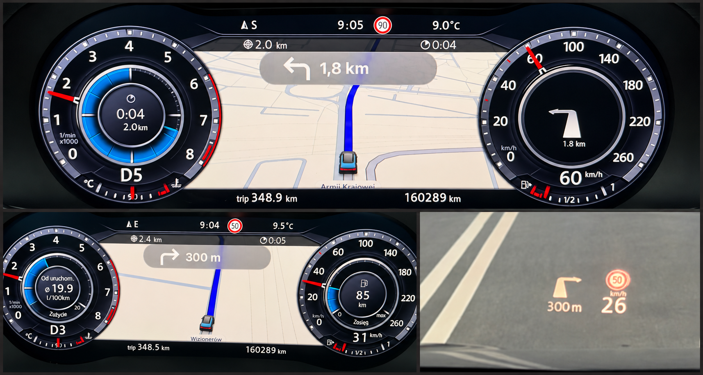

# CarPlay Maps VC for MHI2: MU1367 / MU1427 / AID 791

**CarPlay maps and native navigation guidance on the Volkswagen Active Info Display, with firmware-matched adapters for MHI2 MU1367 and MU1427.**

[Download](#download) · [Install](#installation) · [Display options](#display-options) · [Changelog](#changelog) · [Support](#support-this-project) · [Origin](#origin-and-upstream-project)

**MU1367 / MU1427 development: [tomasz-twardzicki](https://github.com/tomasz-twardzicki)** · Based on [CarPlay Maps VC](https://github.com/omonob/MHI2-Carplay-Maps) by **[omonob (汽车大玩家)](https://github.com/omonob)**

---

> [!WARNING]
> **Use entirely at your own risk.** This project modifies files on your car's infotainment unit. A failed or interrupted install can leave the unit unable to boot. All code, scripts and packages are provided as-is, without warranty of any kind. Neither the original author nor the contributors of this fork are responsible for any damage, malfunction, data loss, warranty or legal consequences, or anything else that results from using them. See [Disclaimer](#disclaimer).

## Overview

This fork extends CarPlay Maps VC on **MU1367** and ports it to **MU1427**, with the **791 AID 12.3** virtual cockpit. Each firmware has its own package and matched HMI adapters; use the installation guide for your exact version.

It combines the phone-rendered CarPlay map and optional turn card with the cockpit's own navigation graphics: native maneuver arrows, distance to the next turn, remaining route distance and travel time. MU1367 also includes native MU settings and audio text. The new MU1367 lane-guidance layer adds factory lane symbols and recommendations; its on-car acceptance is pending.

The baseline project is by **omonob (QCDWJ)**. **tomasz-twardzicki** developed the firmware adaptations and native guidance additions.

*AID and HUD navigation — edited photo collage.*

## Latest MU1367 / 791 changes

**MU1367 v1.4.0 — lane-guidance prerelease:** phone lane instructions feed the
factory cluster lane renderer, preserving lane order, allowed/best-lane
recommendations and branching exits. The OEM lane-display setting and
six-lane window remain in use. Turn cards default **OFF**, with the existing
ON/OFF selector under **App-Connect → Virtual Cockpit settings** retained.
Saved preferences are preserved: select OFF once if Card ON was saved earlier;
the user's preferred **30 fps / IDR5** is not reset.

This is a removable fourth layer over v1.3.0, with exact firmware/payload
checks, verified backups, removal guards and recovery without SD. It passes
761 lane assertions, factory ARM/J9 verification, 19 installer/recovery tests
and a complete four-layer return to OEM. **Phone/app lane delivery, physical
cluster rendering and extended vehicle endurance still require testing.**
See [installation and rollback](./MU1367/lanes/INSTALL.md),
[protocol review](./MU1367/lanes/RESEARCH.md) and
[verification](./MU1367/lanes/VERIFICATION.json). These lane changes apply to
exact **K4525 MU1367 + 791**, and are not part of the MU1427 release below.

## Features (MU1427 / 791)

- **CarPlay map on the virtual cockpit.** MU1427's older AirPlay stack (210.81) keeps the cluster stream's AES key at a different offset. `core.so` is patched to match; without that, every frame decrypts to garbage.
- **Native arrows and maneuver distance on AID and HUD.** The add-on receives the phone's iAP2 guidance and supplies the factory navigation display. Distance uses the OEM formatter, rounding and unit switching; the earlier factor-of-ten error is fixed.
- **Remaining route distance and travel time on AID.** The time is a remaining duration, such as 12 minutes. Clock-time arrival ETA is outside this version.
- **Automatic guidance after boot.** Once installed, the add-on starts with the unit. No manual recorder, shadow check or five-minute test is needed. Guidance clears on route stop, disconnect or stale data; fresh updates restore it, and OEM navigation retains priority.
- **Turn-by-turn card.** The iPhone draws the next-maneuver card on the cockpit map. The default narrow and optional wide cards move **16 pixels lower** to leave room for the native distance/time bar. Map-only positioning is unchanged.
- **Smooth stream.** The cockpit stream requests 30 fps instead of 40, which removed the stutter and lag seen in the car.
- **Display options in the toolbox menu:** the default narrow turn card, a wide turn card, or map only.
- **Steering-wheel control:** short press to zoom the map, long press to switch map views (from the original project).
- **"Ignore navigation-active" for MU1427:** keeps the factory navigation map running in the cockpit while CarPlay navigates. The toolbox's generic patch stops CarPlay from starting on MU1427, so this package includes a build made from MU1427's own HMI classes. The install script picks it automatically.
- **Clean toolbox menu.** The original AUTO MU installers remain available, alongside separate MU1427 native guidance install, status, disable and removal options. A–D research/test entries are removed, and the menu credits both authors.
- **Bounded RAM operation.** Guidance uses a supervised reader and a fixed-size latest-state feed, without recording a route archive or writing navigation captures to SD automatically.
- **Status, diagnostics and restore** entries, including removal of native guidance while keeping the base map-video patch.

Music metadata, cover art, native street/lane graphics and clock-time arrival
ETA are outside this version. The phone-rendered turn card remains available.

**Validation:** D3 unit testing confirmed native AID/HUD arrows, corrected maneuver distance, route distance and travel duration. Reconnection, disconnect clearing and OEM navigation worked in the reported tests. The final package passes host and factory QNX/J9 checks, including installation and rollback. **Automatic startup, operation beyond five minutes and the lowered card position still need their first check on the unit.** See [D3 results](./MU1427/route-guidance/D3-RESULTS.md) and [release verification](./MU1427/route-guidance/RELEASE-VERIFICATION.json).

## Compatibility (MU1427)

| | Supported |
| --- | --- |
| Firmware | **MU1427** (`MHI2_ER_VWG11_K3342_MU1427`), identified by `/ifs/lsd.jxe` = **52,751,492 bytes** |
| Cluster | **791 AID 12.3** |
| Phone | iPhone over USB. Tested with iPhone19,2 on iOS build 24A437; the turn card needs a recent iOS. |

The native guidance installer requires the **MU1427/791 base profile** and checks the firmware and known driver/config sizes before installation. It accepts the factory pair or the tested B4 pair and retains the OEM backups. The 790 installer refuses MU1427; native guidance is not offered for other profiles.

MU1367 uses its separate [compatibility and installation guide](./MU1367/lanes/INSTALL.md).
The original standalone profiles remain available ([see below](#origin-and-upstream-project)).

## Download

**MU1367 / AID 791 — v1.4.0 lane-guidance prerelease:**
[Release](https://github.com/tomasz-twardzicki/MHI2-Carplay-Maps/releases/tag/MU1367-v1.4.0) ·
[Ready-to-extract full toolbox ZIP](https://github.com/tomasz-twardzicki/MHI2-Carplay-Maps/releases/download/MU1367-v1.4.0/CarPlay_Maps_VC_MU1367_791_Native_Lanes_Test.zip) ·
[SHA-256 checksums](https://github.com/tomasz-twardzicki/MHI2-Carplay-Maps/releases/download/MU1367-v1.4.0/SHA256SUMS.txt).
Read the [lane installation and recovery guide](./MU1367/lanes/INSTALL.md).
Existing v1.3.0 users install **step 4 only**; refresh Toolbox menus and
scripts, disconnect CarPlay and reboot first. Fresh installs complete steps
1–3 before step 4. Lane output has not yet been validated on the car.

**MU1367 / AID 791 — v1.3.0 integration with native MU settings:** the separate
[tested bundle](./releases/MU1367/) includes firmware-matched native guidance,
audio text and navigation-active adapters, plus upstream v2 map/mirror UI,
selectable FPS/IDR profiles and turn-card layouts. The user prefers **30 fps /
IDR5** after observing some stutter with both 40 fps options. Read the
[MU1367 installation and rollback guide](./MU1367/settings-v2/INSTALL.md) and
[initial user results](./MU1367/settings-v2/UNIT-RESULTS.md). This is a test
build; extended endurance and detailed acceptance checks remain unrecorded.
The [v1.3.0 release](https://github.com/tomasz-twardzicki/MHI2-Carplay-Maps/releases/tag/MU1367-v1.3.0)
and its ZIP remain unchanged.

**Full MU1427 bundle with automatic native guidance — MU1427 v1.2.0:**
[Release `MU1427-v1.2.0`](https://github.com/tomasz-twardzicki/MHI2-Carplay-Maps/releases/tag/MU1427-v1.2.0) ·
[Download the full ZIP](https://github.com/tomasz-twardzicki/MHI2-Carplay-Maps/releases/download/MU1427-v1.2.0/CarPlay_Maps_VC_MU1427_Native_Guidance_v1.0.0.zip) ·
[SHA-256 checksums](https://github.com/tomasz-twardzicki/MHI2-Carplay-Maps/releases/download/MU1427-v1.2.0/SHA256SUMS.txt).

Use this bundle for the native arrows, route totals and lowered turn cards.
Verify the archive against `SHA256SUMS.txt`, then follow the
[installation guide](./MU1427/route-guidance/INSTALL.md).
The [full toolbox files](./releases/CarPlay_Maps_VC_Full_Toolboxes/VW_SKODA_ALL_CarPlay_Maps_VC_FULL_MQB_Toolbox_V4/) are also kept in this repository.
The older release below contains the video patch only.

**MQB Toolbox V4.2A with CarPlay Maps VC:** release [`MU1427-v1.1.0`](https://github.com/tomasz-twardzicki/MHI2-Carplay-Maps/releases/tag/MU1427-v1.1.0). Direct download: [CarPlay_Maps_VC_FULL_MQB_Toolbox_V4.2A.zip](https://github.com/tomasz-twardzicki/MHI2-Carplay-Maps/releases/download/MU1427-v1.1.0/CarPlay_Maps_VC_FULL_MQB_Toolbox_V4.2A.zip)

Verify the archive with the release's [SHA-256 manifest](https://github.com/tomasz-twardzicki/MHI2-Carplay-Maps/releases/download/MU1427-v1.1.0/FULL_TOOLBOX_SHA256.txt). Its sha256 is `90ee99d17ac70e7653790577c53fe8d248151840ca65aa7ca6ea55eb0ac2df50`.

## Changelog

Release tags use separate `MU1367-vMAJOR.MINOR.PATCH` and
`MU1427-vMAJOR.MINOR.PATCH` sequences. MU1367/790 has its own version
sequence and keeps the `-experimental` suffix. **MU1427 v1.0.0 is the first
confirmed working MU1427 baseline**, rather than the earlier initial port.

| Release | Published | Changes | Previous tag |
| --- | --- | --- | --- |
| [MU1367 / 791 v1.4.0](https://github.com/tomasz-twardzicki/MHI2-Carplay-Maps/releases/tag/MU1367-v1.4.0) | 2026-10-28 | Lane-guidance prerelease: native lane order, recommendations and branching exits through the factory renderer; turn cards OFF by default with App-Connect ON/OFF retained; saved preferences preserved; removable fourth layer with verified backups and no-SD rollback. Host/factory-runtime and full OEM-restore checks pass; on-car lane delivery/rendering and endurance remain pending. | `MU1367-v1.3.0` |
| [MU1367 / 791 v1.3.0](https://github.com/tomasz-twardzicki/MHI2-Carplay-Maps/releases/tag/MU1367-v1.3.0) | 2026-10-28 | Exact MU1367 native guidance, audio text and navigation-active adapters; upstream v2 map/mirror UI; App-Connect FPS/IDR and card-layout settings; bounded logging and verified reverse-order recovery. Initial user testing passed, with 30 fps / IDR5 preferred over both 40 fps profiles. | — |
| [MU1427 v1.2.0](https://github.com/tomasz-twardzicki/MHI2-Carplay-Maps/releases/tag/MU1427-v1.2.0) | 2026-10-19 | Native AID/HUD maneuver arrows and OEM-formatted distance; remaining route distance/travel duration on AID; automatic reader/HMI adapter; separate install/removal; turn cards 16 pixels lower. Final-package startup/extended-operation/card-position checks remain pending as described above. | `mu1427-native-guidance` |
| [MU1367 / 790 v1.0.0-experimental](https://github.com/tomasz-twardzicki/MHI2-Carplay-Maps/releases/tag/MU1367-790-v1.0.0-experimental) | 2026-10-15 | Experimental 30 fps and turn cards for the 790 display, narrow/wide/map-only/lowered-card options and original-core fallback. Offline verified; not tested in a 790 car at publication. No native guidance add-on. | `mu1367-790-experimental` |
| [MU1427 v1.1.0](https://github.com/tomasz-twardzicki/MHI2-Carplay-Maps/releases/tag/MU1427-v1.1.0) | 2026-10-14 | Phone-rendered turn card, smoother 30 fps cluster stream, narrow/wide/map-only display options and active-option status. | `toolbox-plaintext-v1.3.0` |
| [MU1427 v1.0.0](https://github.com/tomasz-twardzicki/MHI2-Carplay-Maps/releases/tag/MU1427-v1.0.0) | 2026-10-13 | First on-car working MU1427/791 release: corrected cluster-stream AES key offset, firmware-matched Ignore navigation-active JAR and bootclasspath install/uninstall fixes. | `toolbox-plaintext-v1.2.0` |
| [MU1427 v0.1.0-experimental](https://github.com/tomasz-twardzicki/MHI2-Carplay-Maps/releases/tag/MU1427-v0.1.0-experimental) | 2026-10-09 | Historical initial MU1427 installer/bootclasspath support, verified offline only. Predates the working baseline's AES and Ignore navigation-active fixes; use v1.0.0 or later. | `toolbox-plaintext-v1.1.0` |

The older MU1427 entries reflect a release-tag reorganization: their original
commit targets, downloadable files, embedded build versions and checksums are preserved. In particular,
MU1427 v1.2.0 retains the original `Native_Guidance_v1.0.0.zip` filename and
internal payload version. Older Git tags remain as commit aliases; use the
versioned release links above for downloads.

## Installation

**MU1367:** follow the [lane-layer guide](./MU1367/lanes/INSTALL.md) or the
[v1.3.0 settings guide](./MU1367/settings-v2/INSTALL.md). The steps below are
for **MU1427**.

Use the **full native-guidance MQB Toolbox bundle** described above. The [full installation guide](./MU1427/route-guidance/INSTALL.md) includes recovery commands and the first installation check.

1. **Upgrading from a D-series test:** remove the old test HMI adapter using its existing menu and fully reboot first. If it is already removed, start from that state. **Keep B4 installed** if present; a factory driver restore is unnecessary.
2. Extract the full bundle's contents **directly to the SD root**, then install or refresh the toolbox scripts and menus. Prefer a clean extraction, preserving existing `Log` folders separately. Check that **Customization → CarPlay Maps VC** shows the new author credits and no A–D test entries.
3. Disconnect the iPhone. Select **Install 791 AID 12.3 (AUTO MU)** and wait for `CPMAP_INSTALL_OK`. Existing users should rerun this to receive the lowered default turn card.
4. Select **Install full native guidance (MU1427 only)**. Expect `CPMAP_GUIDANCE_INSTALLED_REBOOT_REQUIRED` or `CPMAP_GUIDANCE_ALREADY_INSTALLED`. This installs the matched driver/config, HMI adapter and automatic reader, preserving unrelated HMI patches.
5. After both installations, exit the toolbox and **fully reboot the unit once**. Confirm the normal OEM cluster map loads before connecting the phone.
6. Connect the iPhone and start phone guidance. Check the CarPlay map/card, native AID/HUD arrows and maneuver distance, plus remaining route distance and travel duration on AID. Guidance should start automatically.
7. For the first full-package check, let guidance run **beyond five minutes**, check the lowered card position, stop guidance and disconnect/reconnect during another route. Confirm clearing, fresh guidance recovery and OEM navigation priority. Check automatic operation again after a full reboot.

For **video only**, use the existing 791 AUTO MU option and fully reboot; the native guidance installation is optional. With the older published video-only ZIP, its original card position remains in use.

Keep stable power during the whole process. Don't remove the card while the unit is writing, and never install or debug while driving.

Optional: **Customization → Navigation → Ignore navigation-active status from smartphone** keeps the factory navigation running in the cockpit while CarPlay navigates. Undo it with **Uninstall Ignore navigation-active** in the same menu.

## Display options

**MU1367:** use **App-Connect → Virtual Cockpit settings** for stream/layout
and Card ON/OFF. The Toolbox tuning options below apply to **MU1427**.

**Customization → CarPlay Maps VC → carplay-maps-vc-tuning** switches the cockpit view. Every option runs at 30 fps and needs a full reboot after switching.

| Option | Cockpit view |
| --- | --- |
| **Default** | Map with a narrow turn card, 16 pixels lower in the new bundle |
| **Map + wide turn card** | Same lowered position, wider card |
| **Map only, no turn card** | Map without the card |

The options are read from the SD card (`Custom/carplay_maps_vc/tuning/`), so keep the card available when switching. **Show CarPlay Maps VC status** displays the active option.

The iPhone decides the card's size, and it grows with the guidance content (for example lane guidance). The receiver can't limit it. Technical details and the in-car test history are in [`MU1427/791_AID12.3/tuning/`](./MU1427/791_AID12.3/tuning/).

## Diagnostics and restore

- **Collect diagnostics to SD:** writes `Log/cpmap-diag-<time>/` to the card, without modifying the unit. Run it before rebooting, because the runtime logs live in `/ramdisk` and are cleared on reboot.
- **Show CarPlay Maps VC status:** firmware, installed profile and active display option.
- **Show native guidance status:** installed build and reader/HMI counters. During active eligible phone guidance, expect `mode=2 context=0`, increasing ticks/writes and `failures=0 error=0`. The context changes when the phone disconnects or OEM guidance has priority.
- **Disable native guidance now (until reboot):** releases native output immediately and keeps ordinary CarPlay working. No reboot or SD payload is needed to disable; the add-on starts again after reboot.
- **Remove native guidance (reboot):** removes the add-on's startup entries/JAR and restores the OEM iAP2 driver/config. It preserves the base video patch, display choice and unrelated HMI patches. Fully reboot afterwards.
- **Restore factory files:** first removes native guidance if installed, then restores the base video files/runtime through the existing restore procedure. Fully reboot afterwards.

Native guidance does not create the earlier research captures. If the menu is unavailable, the saved MMX controller can disable or remove it without SD; see the [recovery instructions](./MU1427/route-guidance/INSTALL.md#disable-remove-or-restore).

## Repository layout

| Path | Contents |
| --- | --- |
| [`MU1367/lanes/`](./MU1367/lanes/) | Native lane decoder/adapter, card-OFF defaults, build tools, verification and fourth-layer recovery |
| [`MU1367/settings-v2/`](./MU1367/settings-v2/) | Native App-Connect settings, paired map/mirror runtime and v1.3.0 user results |
| [`MU1367/port/`](./MU1367/port/) | Exact MU1367 native guidance/audio/NAI adapters and integration tooling |
| [`releases/MU1367/`](./releases/MU1367/) | Versioned ready-to-use MU1367 bundles, checksums and validation records |
| [`MU1427/`](./MU1427/) | MU1427 notes: the `core.so` AES fix, the display settings, and offline verification against the factory package |
| [`MU1427/791_AID12.3/`](./MU1427/791_AID12.3/) | Standalone MU1427/791 profile: installer, payload, `patch-core-mu1427.py` |
| [`MU1427/791_AID12.3/tuning/`](./MU1427/791_AID12.3/tuning/) | `core.so` display patches, `build-mu1427-cores.sh` (rebuild and verify), test history |
| [`MU1427/NavActiveIgnore/`](./MU1427/NavActiveIgnore/) | MU1427 "Ignore navigation-active" build tooling and jar |
| [`MU1427/route-guidance/`](./MU1427/route-guidance/) | iAP2 driver patches, native HMI adapter/reader, build tools, tests/results and full installation/recovery guide |
| [`releases/CarPlay_Maps_VC_Full_Toolboxes/`](./releases/CarPlay_Maps_VC_Full_Toolboxes/) | Source tree of the full MQB Toolbox package and its SHA-256 manifest |
| [`tests/`](./tests/) | Offline mock-install test |

## Origin and upstream project

CarPlay Maps VC was created by **[omonob (汽车大玩家 / QCDWJ)](https://github.com/omonob)**: the map-video runtime, the steering-wheel controls, the installers and the original toolbox integration. The original project lives at **[github.com/omonob/MHI2-Carplay-Maps](https://github.com/omonob/MHI2-Carplay-Maps)**.

The original release supports these firmware and cluster combinations:

| Firmware | Exact `lsd.jxe` size | 791/794 AID 12.3 | 790 AID 10.5 |
| --- | ---: | :---: | :---: |
| MU1102 | 55,915,411 bytes | ✅ | ✅ |
| MU1367 | 55,840,541 bytes | ✅ | ✅ |
| MU1440 Škoda | 55,840,933 bytes | ❌ | ✅ |

Those original standalone profiles are retained. MU1367/791 also has the
separate integration/settings/lane packages described above. For the other
original profiles, use the upstream project and its releases.

## Support this project

If this project is useful to you and you'd like to support the MU1427 development, you can make an optional contribution via [PayPal](https://paypal.me/ttomcio). Contributions help support the time spent developing, testing and documenting these features. The project remains free and open source; support is entirely optional.

## Open-source notice

- Original author of CarPlay Maps VC: **omonob (QCDWJ)**. MU1427 adaptation, native guidance features, display options and documentation in this fork: **tomasz-twardzicki**. Protocol/maneuver adaptations retain **LuKa's** attribution and GPL notices in the source; see the [route guidance research](./MU1427/route-guidance/README.md).
- The integration scripts, build logic and documentation are licensed under the [GNU GPL v3](LICENSE). Redistribution must keep the attribution and license terms and provide the corresponding source as GPLv3 requires.
- MQB Toolbox, Volkswagen, Škoda, Apple, CarPlay, Apple Maps and other third-party components, names and trademarks belong to their respective owners. GPLv3 does not relicense third-party firmware, toolbox or vendor components.
- The full toolbox is bundled only to provide a ready-to-use SD-card layout; upstream files and license notices are kept intact.
- No unit-specific passwords, private keys, K1/K2, `shadow`, NAVDB ciphertext or vehicle-bound data are published.
- This is an independent community project. It is not affiliated with or endorsed by Volkswagen AG, Škoda Auto, Harman or Apple Inc.

## Disclaimer

**All use of this code, these scripts and these packages is at your own risk.**

- Modifying infotainment software can make the unit fail to boot, disable functions, void warranties, or conflict with local regulations.
- Confirm your exact firmware and cluster, keep stable power, and have a tested recovery route before installing.
- Never install, configure or debug while driving, and never let the cockpit display distract you from the road.

The software is provided "as is", without warranty of any kind, express or implied. In no event shall the original author, the maintainers or any contributor be liable for any claim, damage or other liability arising from, out of, or in connection with the software or its use. This applies to anything that comes out of it, including damage to vehicles, hardware, software or data, and any personal injury, financial loss or legal consequences.

---

MU1427 / AID 791 fork by **[tomasz-twardzicki](https://github.com/tomasz-twardzicki)** · Based on the free, open-source CarPlay Maps VC by **[omonob (QCDWJ)](https://github.com/omonob)** · GPL-3.0

